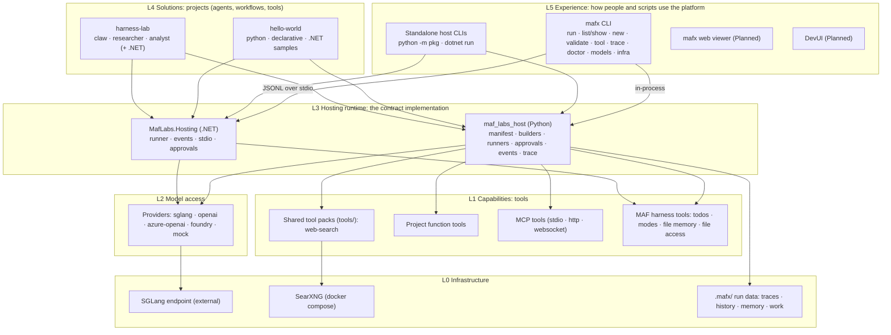

# Platform map

What the repo provides today, organized as a platform: layers, capabilities, contracts and maturity.
Baseline: commit `b35fe61` (2026-10-09). Update this map when an item closes.

## Problem statement
Jean needs a platform to **develop**, **validate**, and **host** AI agents and workflows,
**so that** he can build his own agents to manage aspects of his personal life, run parts of the Trossitec business,
and run experiments that teach him something for his work.

Constraint (from platform intent): the same core across Python and .NET and across hosting models.

## Use domains
| Domain | Example agents | What it demands from the platform |
|---|---|---|
| Personal | assistants for home, schedule, finances | runs unattended (schedules, triggers), private data stays local, persistent memory |
| Trossitec | business operations, client work support | data separated from personal, integrations (mail, calendar, docs) through MCP, reliability |
| Experiments | learning agents, new MAF features, models | fast scaffolding, mock provider, traces and evals to compare runs |

### Capabilities added for the use domains (2026-10-10)
| Capability | Area | Feature |
|---|---|---|
| Scheduled and event-triggered runs (agent runs without a person) | A3 Hosting | A3.F7 Triggers (new) |
| Data and secrets separated per domain (personal, Trossitec, lab) | A9 Infrastructure | A9.F5 Domain isolation (new) |
| Integrations with personal and business systems via MCP (auth, secrets) | A5 Capabilities | A5.F3 MCP tools (scope extended) |
| Persistent memory per agent | A1 Core runtime | A1.F7 Memory scope |

## Pillars
```
            DEVELOP                    VALIDATE                    HOST
   build agents, tools,        prove they work and        run them: CLI today,
   workflows quickly           keep working               services and UI later
   ───────────────────         ───────────────────        ───────────────────
   A5 Capabilities             A8 Quality                 A3 Hosting models
   A6 Experience (build)       A7 Observability           A6 Experience (operate)
   A10 Solutions               A2.F6 Conformance          A9 Infrastructure
                                                          A3.F7 Triggers
   ─────────────────────────── shared foundation ──────────────────────────────
            A1 Core runtime · A2 Contracts · A4 Model access
```

| Pillar | Maturity | Strong | Missing |
|---|---|---|---|
| Develop | 🟢 | scaffolding, tools, mock provider, tool bench, three runtimes | OpenAPI tools, shared tools on .NET |
| Validate | 🔴 | offline tests, `validate`, `doctor`, traces | evals, CI, OpenTelemetry, cross-host conformance |
| Host | 🟡 | CLI, stdio host, standalone hosts | core/surface split, HTTP service, containers, session persistence |

## Areas (L1)
| ID | Area | File |
|---|---|---|
| A1 | Core runtime | [areas/a01-core-runtime.md](areas/a01-core-runtime.md) |
| A2 | Contracts | [areas/a02-contracts.md](areas/a02-contracts.md) |
| A3 | Hosting models | [areas/a03-hosting-models.md](areas/a03-hosting-models.md) |
| A4 | Model access | [areas/a04-model-access.md](areas/a04-model-access.md) |
| A5 | Capabilities | [areas/a05-capabilities.md](areas/a05-capabilities.md) |
| A6 | Experience | [areas/a06-experience.md](areas/a06-experience.md) |
| A7 | Observability | [areas/a07-observability.md](areas/a07-observability.md) |
| A8 | Quality | [areas/a08-quality.md](areas/a08-quality.md) |
| A9 | Infrastructure | [areas/a09-infrastructure.md](areas/a09-infrastructure.md) |
| A10 | Solutions | [areas/a10-solutions.md](areas/a10-solutions.md) |

## Maturity scale
| Level | Meaning |
|---|---|
| **Built** | works, has offline tests, documented |
| **Partial** | works, with known gaps (listed) |
| **Stub** | declared in a schema or flag, not implemented |
| **Planned** | on the roadmap (`README.md`, `docs/architecture.md`) |
| **Missing** | not on the roadmap, but needed for a platform |

## Layers



Cross-cutting concerns run through every layer: **contracts**, **safety**, **observability**, **quality**, **developer workflow**.

## Capability inventory

### L5 Experience
| Capability | Where | Maturity | Notes |
|---|---|---|---|
| Run once (`-p`, text/json/jsonl, exit codes) | `cli/src/mafx/main.py` | Built | answer to stdout, trajectory to stderr |
| Interactive session (input box, slash commands, Ctrl+C) | `cli/src/mafx/interactive.py` | Partial | Ctrl+C on .NET targets desyncs the stream (review F1) |
| Trajectory rendering (full/normal/quiet) | `cli/src/mafx/render.py` | Built | control characters escaped |
| Discovery: `list`, `show` | `main.py` | Built | |
| Scaffolding: `new project/agent/tool/workflow` | `cli/src/mafx/scaffold.py` | Built | python, declarative, dotnet templates; shared tool packages |
| Validation: `validate` | `main.py` | Partial | builds python/declarative on mock; .NET only checks files exist |
| Diagnostics: `doctor`, `models` | `main.py` | Built | checks /models, a Responses call, a tool call, SearXNG |
| Tool bench: `tool inspect`, `tool run` | `main.py` | Built | no model needed; MCP servers included |
| Trace replay: `trace list`, `trace show` | `main.py` | Built | |
| Local services: `infra up/down/status` | `main.py`, `infra/` | Built | docker compose, generated secrets |
| Web viewer (`mafx web`) | | Planned | roadmap step 4 |
| DevUI wiring (`mafx devui`) | | Planned | roadmap step 2; `devui` extra already declared |

### L4 Solutions
| Project | Components | Maturity | Notes |
|---|---|---|---|
| hello-world | greeter (python, declarative, .NET project, .NET single file), get_weather, draft-review workflow, greeting-flow (declarative) | Built | reference for every runtime |
| harness-lab | claw, researcher, analyst (python); claw-dotnet, analyst-dotnet; get-stock-price; web (ref) | Partial | file memory is per session, so the claw watchlist does not persist across runs (F5); .NET agents have no web tools |

### L3 Hosting runtime
| Capability | Python | .NET | Notes |
|---|---|---|---|
| Manifest loading and validation | Built (`manifest.py`) | n/a | .NET registers agents in code; the manifest only points at the project |
| Agent runtime | Built | Built | |
| Workflow runtime | Built (python, declarative) | Missing | `MafLabsHost` has `AddAgent` only |
| Declarative agents and workflows | Partial | n/a | PowerFx `=` expressions need .NET |
| Manifest tools attached at run time | Built | Missing | .NET tools are registered in code; shared tool packs are python only |
| Reasoning effort (manifest, flag, per session) | Built | Built | .NET maps `minimal` to low |
| Tool approvals (approve, deny, always, always_args) | Built (`approvals.py`) | Partial | .NET: no `--allow-tool`; bad decision crashes the host (F4) |
| Workflow human input (`request_info`) | Partial | Missing | one answer is sent to every pending request |
| Workflow approvals | Missing | Missing | `WorkflowRunner.approve` not implemented |
| Turn cancellation | Partial | Missing | no `cancel` message in the protocol (F1) |
| Sessions: reset | Built | Built | |
| Sessions: save and resume | Missing | Missing | `paths.sessions` is declared but unused |
| Trace recording | Built (`trace.py`) | via mafx | standalone .NET runs are not traced |

### L2 Model access
| Provider | Python | .NET | Notes |
|---|---|---|---|
| sglang (Responses, Chat fallback) | Built | Built | reasoning stripped on replay; .NET compat policy for `created_at` and `strict` |
| openai | Built | Built | |
| azure-openai | Built (key or Entra ID) | Partial | .NET: API key only |
| foundry | Built | Missing | |
| mock (offline, deterministic tool calls) | Built | Built | basis of the offline tests |

### L1 Capabilities (tools)
| Capability | Where | Maturity | Notes |
|---|---|---|---|
| Function tools (`@tool`) | projects | Built | unit-test convention in `AGENTS.md` |
| Tool packs (one entry, several tools) | `runtime.py` | Built | |
| Shared tools by reference (`kind: ref`) | `tools/` | Built | python only |
| Web search (SearXNG, DuckDuckGo fallback) and fetch_url | `tools/python/web-search` | Built | SSRF guard on resolve and on the connected socket; extraction blocks the event loop (F8) |
| MCP tools (stdio, http, websocket) | `runtime.py` | Partial | no MCP server in the repo yet; no auth headers or env in the manifest |
| OpenAPI tools | `manifest.py` | Stub | schema accepts `kind: openapi`, runtime rejects it |
| Harness tools (todos, modes, file memory, file access) | MAF `create_harness_agent` | Built | used by harness-lab |

### L0 Infrastructure
| Capability | Where | Maturity | Notes |
|---|---|---|---|
| Model endpoint | external SGLang (`SGLANG_BASE_URL`) | Built | not managed by the repo |
| Web search backend | `infra/searxng` | Built | loopback only, memory capped |
| Run data store | `.mafx/` | Partial | traces, history, memory, work copies; no retention or cleanup |
| Telemetry backend (Aspire Dashboard or Jaeger) | | Planned | roadmap step 2 |

## Cross-cutting

| Concern | What exists | Maturity | Gaps |
|---|---|---|---|
| **Contracts** | `project.yaml` schema (`docs/manifest.md`); host arguments and JSONL event protocol (`docs/host-protocol.md`); factory signatures and `HostContext`; tool pack convention | Built | no protocol version field; no JSON Schema published for events or manifest |
| **Safety** | approvals with no default approve; terminal escape of untrusted text; SSRF guard; workspace re-exec trust check; analysts work on copies of data | Built | prompt injection through fetched pages into file memory is not addressed |
| **Observability** | `trace.jsonl` per run, usage and timing per turn | Partial | no OpenTelemetry, no cross-run metrics |
| **Quality** | 49 tests (offline on mock, plus a few `-m live`), `mafx validate`, `mafx doctor`, ruff | Partial | no evals; no tests for interrupt, .NET protocol edge cases, workflow failure exit codes; no CI |
| **Developer workflow** | `AGENTS.md`, scaffolding, `docs/testing.md`, `docs/process/` | Built | |

## Contracts at a glance
| Contract | Defined in | Producers | Consumers |
|---|---|---|---|
| Workspace marker `maf-labs.yaml` | repo root | | mafx, both hosts |
| Project manifest `project.yaml` | `docs/manifest.md`, `manifest.py` | people, `mafx new` | mafx, Python host, validate |
| Host arguments | `docs/host-protocol.md` | | both hosts |
| Event stream (JSONL) | `docs/host-protocol.md`, `events.py`, `Events.cs` | both hosts | mafx renderer, traces, future evals and viewer |
| Trace file `trace.jsonl` | `trace.py` | `RecordingRunner` | `mafx trace`, future evals and viewer |
| Factory signature | `docs/manifest.md` | projects | Python host |

The event stream is the platform's backbone: telemetry, evals and the viewer on the roadmap all consume it,
so its stability (versioning, schema, completeness) comes before those features.

## Where the roadmap plugs in
| Roadmap step | Layer | Depends on |
|---|---|---|
| 2. Telemetry (OTel, Aspire, DevUI) | cross-cutting, L5 | event stream; both hosts |
| 3. Evals (datasets, suites, baselines) | Quality, L5 | event stream and trace format; mock provider; reliable `ok` and exit codes |
| 4. Viewer (`mafx web`) | L5 | trace format; eval results format |

## Platform intent (answered 2026-10-10)
| Question | Answer |
|---|---|
| Who is it for | A bit of everything: building agents and learning from them. Lab speed matters, and so do stable contracts. |
| Where agents run | Local CLI first, evolving into services and an experience. **The same core and runtime under different hosting models.** |
| .NET | **Full parity** with Python. |
| Memory | **Configurable**: session or persistent scope, chosen per agent. |

### What this means for the architecture
1. **Core and hosting surfaces separate.** The core is: manifest, component builders, providers, runners, approvals
   and the event stream. Hosting surfaces wrap the core: CLI (`-p`, interactive), stdio (for mafx), and later an
   HTTP service and a UI. Today the seam exists (`Runner` + events) but surfaces live next to the core
   (`maf_labs_host/cli.py`, `MafLabsHost.cs`). A new surface must be addable without touching the core.
2. **The event stream is a public contract.** Services and an experience will consume it remotely, so it needs a
   protocol version, a schema, and a transport-neutral definition (stdio today, HTTP/SSE or WebSocket later).
3. **Parity is a requirement, not a goal.** Every gap in the L3 table and the .NET column of L2 is backlog work.
   Parity is proven by contract tests: the same scenario on the mock provider yields equivalent events in both hosts.
4. **Session state must be externalizable.** Services need sessions that survive a process: save, resume, and a
   storage interface (files now, other stores later). `paths.sessions` is the placeholder.
5. **Memory scope is configuration.** A manifest key selects `session` or `persistent` file memory per agent,
   implemented the same way in both hosts.

### Target layering
```
 Experience      mafx CLI | interactive | web viewer | DevUI | future UI
 Hosting models  in-process | stdio host | HTTP service (future) | container (future)
 Core runtime    manifest · builders · providers · runners · approvals · events · sessions · memory scope
 Capabilities    function tools · tool packs · MCP · OpenAPI · harness tools
 Infrastructure  model endpoints · SearXNG · run data · telemetry backend
```
Python and .NET each implement the core runtime and the hosting models with one shared contract.
